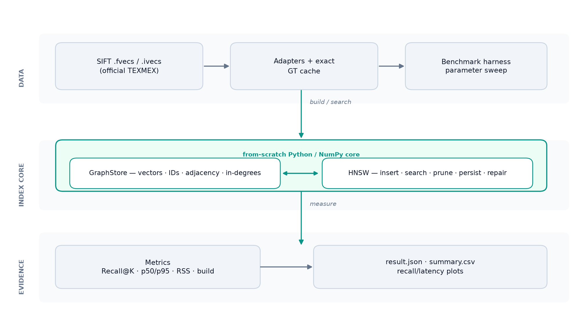
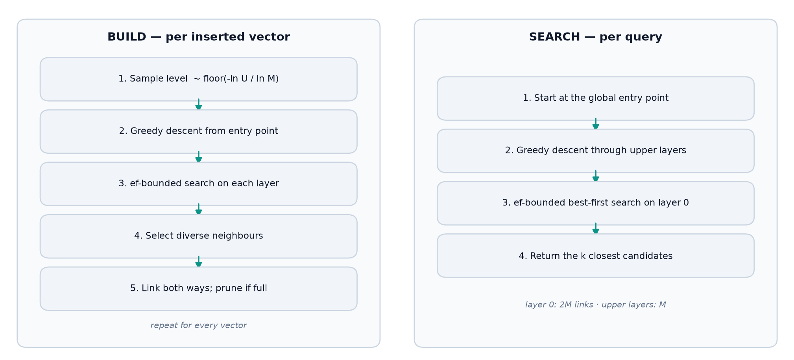
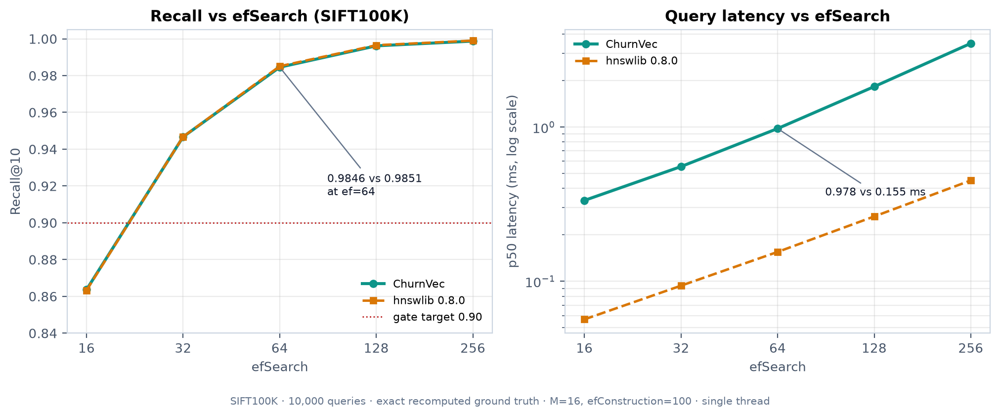
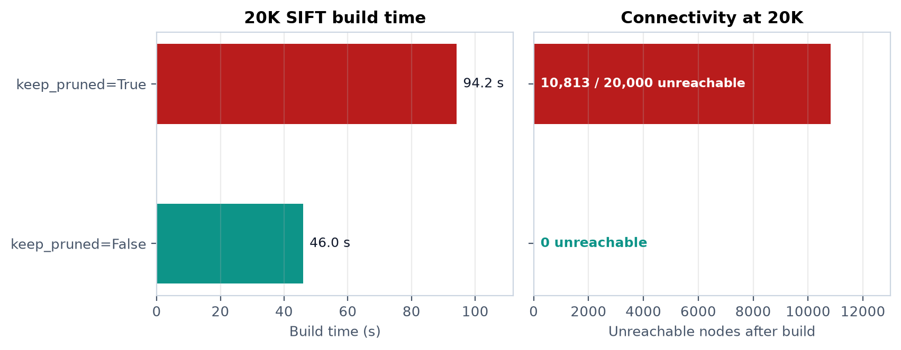

# ChurnVec: A From-Scratch HNSW Vector Index

*Week 1–5 milestone report — static SIFT100K validation and the native-core decision*

- **Milestone:** Weeks 1–5 of the 28-week engineering plan
- **Status:** Week-5 gate passed. Deletion, concurrency, tiering, and compaction are not implemented.
- **Repository:** github.com/sathish123m/vector — milestone commit ab15bee on main
- **Date:** October 2026

## Abstract

This report documents the first five weeks of ChurnVec, a vector indexing project whose longer-term goal is safe deletion, concurrency, and tiered storage over HNSW. The Week 1–5 milestone deliberately stops at the static core: a from-scratch HNSW implementation, SIFT data loaders, an exact brute-force baseline, a measurement harness, a 70-test suite, and a SIFT100K validation gate. On 100,000 SIFT descriptors and 10,000 queries, with exact ground truth recomputed for the prefix, ChurnVec reaches Recall@10 = 0.9846 at efSearch = 64. hnswlib 0.8.0 reaches 0.9851 at the same parameters, a gap of 0.052 percentage points, well inside the two-point gate. The layer-0 graph is fully reachable and needs zero repair links. Build time is 241.82 s and query p50 is 0.978 ms. The measured insertion rate projects a 1M build at 0.67 h, below the three-hour trigger, and p50 is far below the 10 ms trigger, so the native-core decision is to defer a rewrite. The report also documents two engineering findings: an optional pruning policy that fragmented the SIFT graph at scale, and a duplicate-vector edge case that required in-degree tracking and a fallback repair path. Neither finding is hidden inside the headline number.

> **Week-5 gate: PASS** — SIFT100K · Recall@10 0.9846 at ef=64 (target ≥ 0.90) · 0.052 pp behind hnswlib · 0.978 ms p50 · 100,000/100,000 nodes reachable · 0 repair links.

## 1. Context and objectives

Approximate nearest-neighbour search is now a core primitive in retrieval, recommendation, and semantic search. HNSW is one of the most widely used graph indexes because it offers a strong recall–latency trade-off and behaves well at million-vector scale. Building a static HNSW index is therefore a solved engineering problem in libraries such as hnswlib and FAISS. The interesting question for this project is what happens after the static build: vectors are deleted, corrected, re-embedded, and moved between storage tiers, while readers expect a stable view of the collection.

The larger project is organised as a 28-week plan covering deletion, updates, churn workloads, concurrent snapshots, tiered storage, and a compaction scheduler. Weeks 1–5 are the foundation. Before designing a deletion layer, I needed an index I understood end to end, a correctness suite that could catch graph damage, and a measurement harness whose recall numbers could be trusted after the live set changes. That is the scope of this milestone.

### 1.1 What this milestone had to deliver

| Area | Deliverable | Where it lives |
|---|---|---|
| Repository | Pinned Python environment, lockfile, Make targets, reproducible setup | `pyproject.toml`, `uv.lock`, `Makefile` |
| Data | TEXMEX readers, SIFT10K/SIFT100K adapters, MD5-verified downloads | `src/churnvec/bench/datasets.py`, `scripts/download_data.sh` |
| Baseline | Chunked exact top-k for correctness and ground truth | `src/churnvec/core/bruteforce.py` |
| Index | HNSW insert, search, prune, persist, repair, invariants | `src/churnvec/core/hnsw.py`, `graph.py` |
| Correctness | 70 unit, property, and integration tests | `tests/` |
| Measurement | Recall, latency, build time, RSS, plots, JSON/CSV | `src/churnvec/bench/metrics.py`, `scripts/run_phase1.py` |
| Validation | SIFT10K smoke run and SIFT100K Week-5 gate | `reports/phase1/` |
| Documentation | Build report, claims policy, dataset notes, three ADRs | `BUILD_REPORT.md`, `docs/` |

### 1.2 The three questions this milestone answers

- **Can a from-scratch implementation reach competitive recall?** The target is Recall@10 ≥ 0.90 on SIFT100K at efSearch = 64, within roughly two percentage points of hnswlib at matched parameters.
- **Is Python/NumPy fast enough for the next stage?** The plan defines two triggers for starting a native core: a projected 1M build above three hours, or a query p50 above 10 ms.
- **Is the graph correct, not just high-scoring?** The index must expose and check degrees, in-degrees, ID maps, self-loops, duplicates, and layer-0 reachability. A recall number produced by a repair chain that masks a broken build is not a passing result.

### 1.3 Scope boundaries

The following are explicitly out of scope for this milestone. They are not partially implemented, and no result in this report should be read as evidence about them:

- deletions, updates, tombstones, immutable segments, or segment compaction;
- concurrent readers or writers, snapshots, or crash consistency;
- hot/warm/cold tiering, memory mapping, or storage offload;
- the learned compaction scheduler, HTTP/gRPC API, or service deployment;
- a full SIFT1M build, text-embedding benchmarks, or full GIST1M.

## 2. Background

### 2.1 HNSW in brief

HNSW stores vectors in a multi-layer proximity graph. Every vector appears in layer 0; each vector is also promoted to higher layers with a level sampled from an exponential distribution, so upper layers form a sparse navigation hierarchy. A node keeps at most M links per upper layer and at most M0 = 2M links in layer 0. Insertion descends greedily from the entry point through the upper layers, runs an ef-bounded best-first search on each layer at or below the new node's level, selects neighbours, and adds reciprocal links. When a neighbour list is full, it is pruned with a diversity heuristic that prefers links which reach new regions over links that are merely close to each other.

Search uses the same structure in reverse: greedy descent through the upper layers, then an ef-bounded search on layer 0. efSearch is the main run-time knob: larger values explore more candidates and raise recall at the cost of latency. efConstruction is the build-time equivalent. The HNSW paper also describes an optional keepPrunedConnections fill, which retains rejected candidates in otherwise empty slots. That option becomes important in Section 6.1.

The algorithm is conceptually simple, but the implementation has sharp edges: fixed-capacity neighbour lists, reciprocal-link pruning, tie-breaking on equal distances, and the fact that a node can remain in the graph with outgoing links but no incoming link. Those edges are why this milestone invested in invariants and property tests before optimising throughput.

### 2.2 Metrics that matter

- **Recall@K** against exact top-K neighbours. It is the quality gate, but only if the ground truth matches the exact live snapshot and metric.
- **Latency percentiles**, not just the mean. p50 describes the common case; p95 and p99 expose tail behaviour that a mean hides.
- **Build time and insertion rate**, because construction dominates the cost of a static index and determines whether a 1M build is practical on the available machine.
- **Memory**, split into the index's own estimated footprint and process RSS. They answer different questions and should not be conflated.

## 3. Design and implementation

### 3.1 Architecture

The implementation separates the index core from the benchmark harness. The core knows nothing about SIFT or about JSON result files; the harness knows nothing about graph internals beyond the public search and statistics API. That boundary made it possible to test the index on synthetic data, swap in exact ground truth for a prefix, and later add churn workloads without rewriting the graph.



*Figure 1. System layers. The index core is dependency-free apart from NumPy; the harness owns data loading, ground truth, and evidence.*

### 3.2 Distance kernels

All vectors are stored as contiguous float32. The squared-L2 hot path uses the norm-expanded form ||x − q||² = ||x||² − 2x·q + ||q||², computed with a matrix-vector product and clamped at zero to absorb floating-point noise. This avoids materialising an (n, d) difference matrix and avoids a square root, since squared L2 preserves ordering. Row norms are precomputed once at insertion. Cosine and inner-product variants are implemented behind the same interface; inner product is returned as its negative so that smaller always means closer. Zero vectors and non-finite inputs are handled explicitly rather than left to produce NaNs deep inside the graph.

### 3.3 Graph storage and invariants

`GraphStore` owns vectors, row norms, external int64 IDs, per-node levels, layer-0 adjacency, sparse upper-layer adjacency, and in-degree counts. Layer 0 is a dense `(capacity, 2M)` int32 matrix because almost every node lives there; upper layers use dictionaries keyed by node because only about 1/M of nodes reach layer 1 and far fewer reach higher layers. Capacity grows geometrically and preserves every array and map. External IDs are decoupled from internal slots so that deletion and stable references remain possible later.

The validator checks the properties that a recall benchmark cannot see:

- entry point is valid and equals the maximum node level;
- no node exceeds M links per upper layer or 2M links in layer 0;
- no self-loops, out-of-range links, or duplicate neighbours;
- the external-ID map is bijective and contains no duplicate IDs;
- in-degree bookkeeping matches the adjacency arrays after every mutation;
- layer counts are nested (every node in layer l is also in layer l−1);
- every node is reachable from the entry point by a directed BFS on layer 0.

Reachability is reported rather than asserted inside normal insertion, because a bulk build may need a repair pass for degenerate data. The build harness treats any unreachable node as a hard failure before benchmarking.

### 3.4 Insertion and search

*Figure 2. The two traversals implemented by the index. Build repeats the left-hand path for every vector; search repeats the right-hand path for every query.*



```text
insert(x):
  level = sample_level()
  ep = entry_point
  for layer in max_level .. level+1:  ep = greedy_search(x, ep, layer)
  for layer in min(level, max_level) .. 0:
      candidates = ef_search(x, [ep], efConstruction, layer)
      neighbours = select_diverse(candidates, M)
      connect_both_ways(x, neighbours, layer)
      prune_full_lists(neighbours, layer)
      ep = nearest(candidates)
  if level > max_level: entry_point = x; max_level = level
```

Search starts at the entry point and descends greedily to layer 1, then runs a best-first search on layer 0 with a candidate min-heap, a result max-heap, and a visited-token array that avoids clearing a full boolean vector per query. The result heap is capped at ef; the search stops when the closest unexplored candidate is farther than the worst result. The returned list is sorted by distance and truncated to k. Inputs are validated for dimension, finiteness, positive k, and non-empty index.

The neighbour-selection heuristic is the part that most affects graph quality. Candidates are considered in distance order; a candidate is kept only if it is closer to the query than to every already-selected neighbour. This preserves links that reach new regions instead of filling the list with a dense cluster. A `simple` selection mode is retained for ablation, and `keep_pruned` is exposed as an experimental option.

### 3.5 Persistence and repair

Indexes persist to a single `.npz` file containing metadata, vectors, norms, external IDs, levels, layer-0 adjacency, upper-layer adjacency, and the RNG state. Loading rebuilds in-degree bookkeeping and keeps the index mutable: a loaded index accepts new vectors and still passes the same invariants. The benchmark saves the hnswlib index to a file to report a comparable on-disk size.

`repair_connectivity()` is a bulk-build fallback, not part of normal search. It first checks reachability; if the graph is healthy it returns zero without touching it. If nodes are unreachable, it threads a deterministic layer-0 chain through them and reports how many links it added. SIFT100K needs zero repairs. A synthetic set of 100 identical vectors needs many, which is exactly why the count is surfaced in every result rather than hidden.

### 3.6 Data adapters and measurement harness

The TEXMEX readers parse the int32 dimension prefix followed by float32 or int32 payloads, support bounded prefix reads, and reject empty or truncated files. SIFT10K, SIFT100K, and SIFT1M adapters share one `Dataset` shape. The harness resolves ground truth by snapshot: shipped SIFT ground truth is used only when the base is exactly the shipped base; otherwise exact top-k is recomputed with chunked brute force and cached. A naive 10,000 × 1,000,000 float32 distance matrix would be 40 GB, so only IDs are kept.

The measurement harness builds the index under a background RSS sampler, warms up 32 queries, times every remaining query with `perf_counter_ns`, and records mean, p50, p95, p99, min, max, and QPS. It runs the same ef sweep against hnswlib with matched M, efConstruction, and ef, single-threaded for both engines. Results are written as JSON and CSV with run metadata (timestamp, command, versions, host, git state) and as recall/latency plots. A gate object records the target, measured recalls, gap, and pass/fail.

## 4. Experimental method

### 4.1 Datasets and ground truth

| Dataset | Base | Queries | Learn | Ground truth | Use |
|---|---|---|---|---|---|
| SIFT10K | 10,000 × 128 | 100 × 128 | 25,000 × 128 | 100 × 100 | Harness smoke test |
| SIFT100K | 100,000 × 128 | 10,000 × 128 | — | 10,000 × 100 exact | Week-5 gate |
| SIFT1M | 1,000,000 × 128 | 10,000 × 128 | 100,000 × 128 | 10,000 × 100 shipped | Downloaded, not built |

Both archives come from the official IRISA/CNRS TEXMEX corpus and were verified locally: `sift.tar.gz` MD5 `b23d1b3b2ee8469d819b61ca900ef0ed`, `siftsmall.tar.gz` MD5 `0b8324a7a82d7f2663d7dcbd57642df7`. SIFT100K is the first 100,000 rows of the SIFT1M base. Because the shipped ground truth is only valid for the exact 1M base, it was not reused. The harness computed exact top-100 IDs for the 100K prefix with chunked brute force and cached them as a 10,000 × 100 int32 array (3.8 MB). SIFT10K has only 100 queries, not 10,000; that initially looked like a loader bug and is documented in Section 6.3.

### 4.2 Parameters

| Parameter | Value | Reason |
|---|---|---|
| M | 16 | Standard HNSW operating point; layer 0 uses 2M = 32 links |
| efConstruction | 100 | Matches the hnswlib comparison and keeps build cost reasonable |
| efSearch sweep | 16, 32, 64, 128, 256 | Shows the full recall–latency curve, not a single point |
| Gate point | efSearch = 64 | Defined by the milestone |
| k | 10 | Recall@10 is the gate metric |
| Metric | Squared L2 | SIFT standard; ordering-identical to L2 |
| Pruning | keep_pruned = False | Chosen after the experiment in Section 6.1 |
| Seed | 42 | Construction is single-threaded and seeded |

### 4.3 Protocol

- Build and search run in one process on one machine, single-threaded, with no background benchmark load.
- The index is constructed inside the RSS monitor so preallocation is included in the memory delta.
- Each ef point warms up with 32 queries, then times all 10,000 queries individually; recall is computed over all of them.
- hnswlib uses the same M, efConstruction, ef sweep, seed, metric, and single-thread setting.
- Recall uses exact top-100 IDs; the reported metric is Recall@10.
- The full gate was run twice (27 and 28 October 2026). Both runs produced identical recall; timing differed by about 2%.

### 4.4 Environment

| Item | Value |
|---|---|
| Machine | Apple M1, arm64, 8 GB RAM, macOS 15.1 |
| Python | 3.12.14 in a project virtual environment |
| Core libraries | NumPy 2.5.4, pandas 3.1.0, matplotlib 3.11.2, psutil 7.2.2 |
| Comparison | hnswlib 0.8.0 |
| Tests | pytest 9.1.1, Hypothesis 6.170.12 |
| Disk | 8.2 GB free at the start; SIFT1M extracted is about 550 MB |

## 5. Results

### 5.1 E0: SIFT10K smoke test

E0 exists to validate the harness, not to make a performance claim. With 10,000 base vectors and 100 queries, both engines reach 0.9970 Recall@10 at ef=64. The build takes 21.41 s and the estimated index footprint is 6.4 MB. The important outcome is that the loader, exact ground truth path, timing loop, hnswlib comparison, JSON output, and plots all work end to end before spending four minutes per SIFT100K build.

| efSearch | ChurnVec Recall@10 | ChurnVec p50 (ms) | hnswlib Recall@10 | hnswlib p50 (ms) |
|---|---|---|---|---|
| 16 | 0.9590 | 0.295 | 0.9620 | 0.035 |
| 32 | 0.9900 | 0.561 | 0.9910 | 0.042 |
| 64 | 0.9970 | 0.874 | 0.9970 | 0.071 |
| 128 | 1.0000 | 1.620 | 1.0000 | 0.112 |

### 5.2 E1: SIFT100K Week-5 gate

The gate run uses 100,000 base vectors, all 10,000 queries, and exact ground truth recomputed for the prefix. At ef=64 ChurnVec reaches 0.9846 and hnswlib reaches 0.9851. The gap is 0.052 percentage points in hnswlib's favour, far inside the two-point tolerance. Recall is essentially indistinguishable across the entire sweep, which is the expected outcome if the graph construction and search are correct.



*Figure 3. Recall and p50 latency against efSearch on SIFT100K. The recall curves overlap; the latency curves do not. The gate point is ef=64.*

| efSearch | ChurnVec Recall@10 | ChurnVec p50 / p95 (ms) | hnswlib Recall@10 | hnswlib p50 / p95 (ms) |
|---|---|---|---|---|
| 16 | 0.8637 | 0.334 / 0.442 | 0.8633 | 0.057 / 0.078 |
| 32 | 0.9467 | 0.554 / 0.676 | 0.9468 | 0.094 / 0.140 |
| 64 | 0.9846 | 0.978 / 1.142 | 0.9851 | 0.155 / 0.208 |
| 128 | 0.9962 | 1.828 / 2.252 | 0.9965 | 0.263 / 0.360 |
| 256 | 0.9987 | 3.485 / 4.371 | 0.9990 | 0.451 / 0.599 |

### 5.3 Build, memory, and reachability

| Metric | ChurnVec | hnswlib 0.8.0 |
|---|---|---|
| Build time (100K) | 241.82 s | 20.57 s |
| Insertion rate | 413.5 vectors/s | 4,862 vectors/s |
| Process RSS start → peak | 150.2 → 167.8 MB | 96.6 → 124.3 MB |
| Estimated index footprint | 63.8 MB | 62.99 MB index file |
| Max level | 4 | not exposed |
| Layer-0 reachability | 100,000 / 100,000 | not exposed |
| Repair links | 0 | not applicable |

The memory figures are close, which is expected because both implementations store the same vectors and roughly the same number of links. The speed figures are not close: hnswlib is about 6.3× faster per query at ef=64 and about 11.8× faster to build. This is the expected cost of a Python/NumPy implementation that crosses into interpreted code for graph traversal, heap operations, and per-neighbour decisions. It is the main input to the native-core decision, not a reason to distrust the recall result.

### 5.4 Reproducibility

The full gate was rerun on 28 October 2026 from the committed code. Recall was identical to four decimal places: 0.9846 for ChurnVec and 0.9851 for hnswlib. The rerun built in 247.21 s and measured p50 = 0.994 ms, about 2% and 1.6% slower than the archived run, with zero unreachable nodes and zero repair links. That variation is normal for a laptop and does not change any conclusion. The committed evidence in `reports/phase1/` is the 27 October run; the rerun log is retained separately.

### 5.5 The 1M projection

| Projection input | Value |
|---|---|
| Measured insertion rate | 413.5 vectors/s |
| Linear 1M build projection | 0.672 h (40.3 min) |
| Measured p50 at ef=64 | 0.978 ms |
| Build trigger (> 3 h) | not fired |
| Latency trigger (> 10 ms) | not fired |

This is a linear projection from the 100K run, not a 1M measurement. HNSW insertion cost grows with graph depth and with the number of candidate links examined, and Python overhead may change with graph size. The projection is a gate input, not a benchmark result. A measured SIFT1M build is the first item in Section 10.

## 6. Engineering findings

Two findings mattered more than the headline recall number. The first was a construction bug that produced an excellent-looking recall score from a fragmented graph. The second was an edge case in which a fixed-capacity graph could strand nodes even though every individual pruning decision was locally valid.

### 6.1 Case study: keep_pruned fragmented the SIFT graph

The first SIFT100K run used `keep_pruned=True`, the optional fill that retains rejected candidates when a neighbour list has spare capacity. It reported Recall@10 = 0.9881 at ef=64, which passed the gate. It also reported 99,673 repair links and a build time of 435.19 s. A graph that needs a repair chain through most of its nodes is not a graph that passed; the repair had reconstructed connectivity after the fact.

I isolated the effect on a 15,000-vector prefix. BFS from the entry point reached only 7,050 nodes; 7,950 were unreachable. The unreachable set was not a handful of random nodes: both components had high internal degree, and there was exactly one directed cross-edge between them. That pointed to a structural split during insertion rather than node loss. The likely mechanism was that the fill retained links farther from the source than an already-selected neighbour, consuming capacity that would otherwise have held cross-cluster bridges once the graph saturated.

A controlled 20,000-vector experiment with exact 20K ground truth confirmed it. Recall was measured on 1,000 queries, so the two recall values are comparable to each other but not to the 100K gate:

| Pruning policy | Build | Unreachable | Repair links | Recall@10, ef=64 |
|---|---|---|---|---|
| keep_pruned = True | 94.2 s | 10,813 / 20,000 | 0 before repair | 0.9970 |
| keep_pruned = False | 46.0 s | 0 | 0 | 0.9952 |



*Figure 4. The 20K controlled experiment. Disabling the optional fill produces a connected graph and cuts build time roughly in half.*

The fix was to default to hnswlib-style pruning: select the diverse neighbour set and do not fill the remaining slots with rejected candidates. The SIFT100K rerun then reported 0 unreachable nodes, 0 repair links, 241.82 s build time, and 0.9846 recall at ef=64. The 0.35 pp recall change is far inside the gate and buys a naturally connected graph plus a much faster build.

The caveat matters: keepPrunedConnections is a legitimate option in the HNSW paper, and this result is specific to this data, this insertion order, and this implementation. The conclusion is not that the paper is wrong. The conclusion is that a fill policy can interact badly with graph saturation, and that repair-link count must be a first-class metric because recall alone can hide the damage. SIFT contains near-duplicate descriptors in both components, so a reachable twin could satisfy many queries even when the graph was split.

### 6.2 Case study: duplicate vectors and reachability

A Hypothesis property test generated a dataset of identical vectors and found one unreachable node. The cause is a combination of zero distances and fixed-capacity pruning. Every candidate is equally close, so tie-breaking favours low slot IDs; reciprocal links to new nodes are often rejected when a neighbour list is full. A node can keep outgoing links while losing every incoming link, which makes it unreachable from the entry point. With 100 identical vectors, only 36 were reachable before repair.

The fix has three layers. First, `GraphStore` tracks in-degrees incrementally for layer 0 and upper layers. Second, link insertion returns whether the new node survived pruning; a new node that loses every reciprocal link triggers a repair attempt across several selected sources, and an existing node's last incoming edge is not dropped if another selected neighbour can be removed instead. Third, a bulk `add_items` runs `repair_connectivity()` only after checking reachability; healthy graphs are untouched. A 100-vector all-identical build now ends with 100/100 reachable and reports its repair count. SIFT100K still reports zero.

This is a structural fallback, not a quality-preserving construction for adversarial duplicate distributions. The repair chain guarantees reachability, but it does not guarantee that the inserted duplicate is easy to find or that recall on such data is meaningful. The limitation is documented rather than presented as a general connectivity guarantee.

### 6.3 Smaller issues found during the build

| Symptom | Cause | Fix |
|---|---|---|
| `uv sync` timed out repeatedly | Concurrent PyPI downloads were unreliable on the network | Serial downloads with longer timeout; lockfile retained |
| `import churnvec` failed after editable install | macOS hidden flag on generated `.pth`; Python skipped it | `PYTHONPATH=src`, pytest `pythonpath`, Makefile export |
| `.fvecs` tests raised TypeError | NumPy 2.5 rejects `fromfile(count=None)` | Omit `count` when no limit is requested |
| HNSW recall tests scored 0.04 | Test helper assigned distances to the ground-truth IDs | Corrected the tuple unpacking; index was fine |
| Build RSS delta was zero | Index preallocated before the RSS monitor started | Construct inside the monitor |
| hnswlib version was null in JSON | The module has no `__version__` | Read it with `importlib.metadata` |
| SIFT10K loaded 100 queries | The official small set has 100, not 10,000 | Documented; E0 is a 100-query smoke test |
| Prefix could reuse 1M GT | Shipped GT is only valid for the exact 1M base | Recompute and cache exact GT for the snapshot |

The pattern across these issues is that several failures looked like index bugs but were measurement or environment bugs, and one failure looked like a pass but was a graph bug. The report keeps both categories because a credible benchmark needs to distinguish them.

## 7. Week-5 gate decision

> **Decision: defer the native core** — The Python/NumPy core passes the static Week-5 gate. Neither native-core trigger fired. Revisit the decision after a measured SIFT1M build and after churn/concurrency profiling.

| Criterion | Required | Measured | Verdict |
|---|---|---|---|
| SIFT100K Recall@10 at ef=64 | ≥ 0.90 | 0.9846 | pass |
| Gap to hnswlib | ≤ ~2 pp | 0.052 pp worse | pass |
| 1M build projection | < 3 h | 0.672 h | pass |
| Query p50 | < 10 ms | 0.978 ms | pass |

The decision rests on the gate, not on a claim that Python is fast. hnswlib is about 6.3× faster per query and 11.8× faster to build on the same machine. A native rewrite would close that gap, but it would not improve the static recall result, and it would move effort away from the deletion and concurrency work that defines the project. The sensible sequence is to measure the 1M build and profile churn first, then decide whether the bottleneck is the language or the algorithm.

The decision would change if a measured 1M build exceeds three hours, if p50 at the target ef exceeds 10 ms, or if churn and concurrent-read experiments show that Python cannot meet their latency or throughput targets. It would also change if multi-threaded scaling becomes a requirement, because the current implementation is single-threaded and does not attempt to release the GIL.

> **Claims discipline** — Allowed: “On a static SIFT100K snapshot with exact recomputed ground truth, the from-scratch Python/NumPy HNSW matched hnswlib's Recall@10 within 0.052 pp at matched parameters, while being substantially slower.” Forbidden: “HNSW cannot delete”, “we solved deletion/concurrency/tiering”, “first vector database with deletes”, “production-ready”, “faster than hnswlib”, “we built SIFT1M”, “guaranteed connectivity”.

## 8. Limitations and threats to validity

- **No 1M run.** The 0.67 h figure is a linear projection from 100K. Insertion cost grows with graph depth, and the laptop has only 8 GB of RAM; a real 1M build may be slower and may need a larger machine.
- **No churn.** Deletion, updates, tombstones, segments, and live-set ground-truth recomputation beyond a static prefix are not implemented. The churn design exists only as a plan.
- **No concurrency.** There is no snapshot registry, lock-free read path, or writer coordination to evaluate.
- **No tiering or compaction.** Hot/warm/cold storage, memory mapping, and the scheduler are future milestones.
- **Python speed.** The 6.3× query gap is real. Recall parity is not speed parity, and this implementation is not production-ready.
- **Repair is structural.** It guarantees reachability on degenerate data but does not characterise recall on adversarial duplicate distributions.
- **Ties and GT.** Official ground truth stores IDs, not distances. Equal-distance ties can reorder IDs and perturb recall slightly. The integration test compares distances where possible.
- **Single machine, single run.** The gate was run twice, but both runs used the same M1 laptop and the same single-threaded protocol. Cross-machine and multi-threaded behaviour are unmeasured.
- **RSS is not index size.** Process RSS includes Python, NumPy, the loaded base vectors, and the ground-truth cache. The 63.8 MB figure is the index's own estimate.

## 9. Work log

The work proceeded in five stages. The ordering is useful because several later decisions only make sense in light of earlier failures.

- **Foundation.** Initialised the repository on `main`, pinned Python 3.12, created the lockfile and Make targets, and documented the setup. PyPI timeouts forced serial downloads with a longer timeout.
- **Data.** Downloaded the official TEXMEX SIFT and SIFT10K archives, verified both MD5s, and wrote `.fvecs`/`.ivecs` readers with prefix support and explicit ground-truth handling.
- **Core.** Implemented the distance kernels, `GraphStore`, exact brute force, and HNSW insertion/search/pruning/persistence. Added level sampling, the diversity heuristic, reciprocal links, and the `.npz` format.
- **Correctness.** Added invariant checks, in-degree tracking, property tests, and the duplicate-vector repair path. Fixed a test-helper bug, a NumPy reader bug, and the macOS `.pth` import issue.
- **Validation.** Built the measurement harness and both experiment configs. Ran SIFT10K, then SIFT100K. The first 100K run exposed the keep_pruned fragmentation; the controlled 20K experiment led to the pruning default change and a clean rerun at 0.9846.
- **Documentation.** Wrote the build report, claims policy, dataset notes, and three ADRs; archived the failed run logs as evidence; committed the milestone.

## 10. Next steps

The next milestone should start with measurement, not architecture. Two questions dominate: how the index behaves at 1M scale, and what happens to recall and latency when the live set changes.

- **Measured SIFT1M build.** Run the same protocol on a machine with enough RAM and disk, or build a measured 250K/500K ladder and fit the growth curve instead of assuming linearity.
- **Deletion design.** Use immutable segments plus tombstones and an atomic snapshot registry. Deletion by stable external ID, not by internal slot. Compact segments when dead fraction or query cost crosses a threshold.
- **Churn workloads.** Hold out SIFT base vectors for inserts, delete by stable ID, and recompute exact ground truth at checkpoints. Never compare against the shipped static ground truth after mutation.
- **Concurrency.** Compare the snapshot registry against per-node and global-lock baselines; measure read latency during compaction and writer throughput.
- **Tiering.** Start with hot/cold as the MVP and run the hot/warm/cold ablation. Measure recall and p95 under tier movement.
- **Native-core review.** Revisit after the 1M and churn profiles. Use the Python implementation as the reference oracle for any port.
- **CI.** Run the 66 fast tests on every change; keep dataset and slow tests opt-in.

## 11. Conclusion

The Week 1–5 milestone delivered a from-scratch HNSW index, a trustworthy measurement harness, a 70-test correctness suite, and a reproducible SIFT100K gate result. At efSearch = 64, ChurnVec reaches Recall@10 = 0.9846 against hnswlib's 0.9851, with a fully reachable graph and zero repair links. The gate passes with a large margin on recall and on both native-core triggers.

The more valuable outcome is the evidence behind the number. The first 100K run passed recall while hiding a fragmented graph behind 99,673 repair links; the duplicate-vector test found a reachability bug that random data never exposed. Fixing both changed the default pruning policy and added in-degree-aware link handling. Those are the kinds of failures that would become much harder to diagnose after deletion and concurrency are added.

Python/NumPy is sufficient for the static milestone. It is not yet proven for churn, concurrency, or production throughput, and hnswlib remains substantially faster. The next step is to measure 1M and then build the deletion layer on top of a graph whose correctness properties are already explicit.

## References

- Malkov, Y. A., and Yashunin, D. A. (2020). Efficient and robust approximate nearest neighbor search using Hierarchical Navigable Small World graphs. *IEEE Transactions on Pattern Analysis and Machine Intelligence*, 42(4), 824–836.
- Jégou, H., Douze, M., and Schmid, C. (2011). Product quantization for nearest neighbor search. *IEEE Transactions on Pattern Analysis and Machine Intelligence*, 33(1), 117–128.
- IRISA/CNRS TEXMEX corpus. SIFT and SIFT10K datasets. `ftp://ftp.irisa.fr/local/texmex/corpus/`.
- Malkov, Y. hnswlib: Header-only C++/Python implementation of HNSW. `https://github.com/nmslib/hnswlib` (version 0.8.0 used here).
- Johnson, J., Douze, M., and Jégou, H. (2019). Billion-scale similarity search with GPUs. *IEEE Transactions on Big Data*, 7(3), 535–547.

---

## Appendix A — Commands

```text
# Environment
make setup

# Data (official TEXMEX, MD5-verified)
make data

# Tests
make test          # 70 tests
make test-fast     # excludes slow/dataset tests

# Benchmarks
make e0            # SIFT10K smoke
make e1            # SIFT100K Week-5 gate

# Direct invocation
PYTHONPATH=src .venv/bin/python scripts/run_phase1.py \
  --config configs/experiments/e1_sift100k.yaml
```

## Appendix B — Test inventory

| File | Tests | Coverage |
|---|---|---|
| `unit/test_distance.py` | 13 | L2/cosine/IP batch vs scalar, norm kernel, zero vectors, validation |
| `unit/test_datasets.py` | 9 | `.fvecs`/`.ivecs` round-trip, prefix limits, SIFT adapters, GT cache |
| `unit/test_bruteforce.py` | 10 | Exact top-k vs naive, chunking, cosine/IP, validation |
| `unit/test_graph.py` | 6 | Capacity growth, duplicate IDs, neighbour validation, in-degree invariants |
| `unit/test_hnsw.py` | 23 | Exact search, IDs, duplicates, persistence, metrics, selection variants, repair |
| `unit/test_metrics.py` | 5 | Recall, latency, RSS, JSON serialisation |
| `property/test_hnsw_properties.py` | 2 | Random graphs: connectivity and exact distances at full-width ef |
| `integration/test_siftsmall.py` | 2 | SIFT10K recall smoke; shipped-GT distance agreement |

Final result: `70 passed` in about 23 s on the committed code. The fast subset is 66 tests; the two SIFT10K integration tests skip automatically when the dataset is absent.

## Appendix C — Evidence map

| Claim | Evidence |
|---|---|
| SIFT100K Recall@10 = 0.9846 | `reports/phase1/e1_sift100k/result.json`, `summary.csv`, `run.log` |
| hnswlib Recall@10 = 0.9851 | Same result JSON and log |
| Build 241.82 s; p50 0.978 ms | Same result JSON and log |
| Zero repair links | `build.stats.repair_links` in the result JSON |
| SIFT10K Recall@10 = 0.9970 | `reports/phase1/e0_siftsmall/result.json` |
| 70 tests pass | `reports/phase1/test_run.txt` |
| MD5 verification | `scripts/download_data.sh`; Section 4.1 |
| keep_pruned fragmentation | `reports/phase1/archive/` logs; Section 6.1 |
| Duplicate repair | `tests/unit/test_hnsw.py`; Section 6.2 |

## Appendix D — Claims policy

The short version of `docs/claims.md`:

- **Allowed.** From-scratch Python/NumPy HNSW for Weeks 1–5; SIFT100K Recall@10 0.9846 at ef=64, within 0.052 pp of hnswlib; 241.82 s build and 0.978 ms p50 on this machine; the Week-5 gate passed and the native-core trigger did not fire; the keep_pruned fragmentation was found and fixed; duplicate vectors are supported with a fallback repair path.
- **Forbidden.** “HNSW cannot delete”; “we solved deletion/concurrency/tiering/compaction”; “first vector database with deletes”; “production-ready”; “faster than hnswlib”; “we built SIFT1M”; “guaranteed graph connectivity”; “the shipped SIFT ground truth is valid after inserts or deletes”; “the ML scheduler works”.
